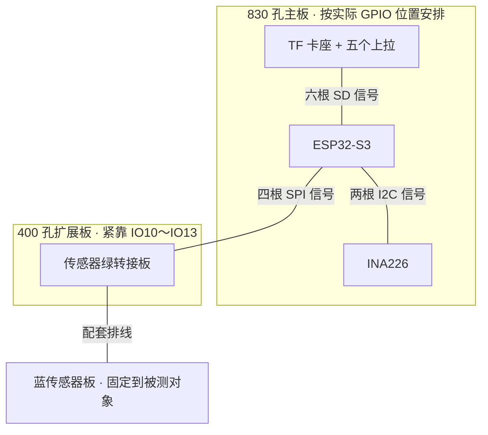
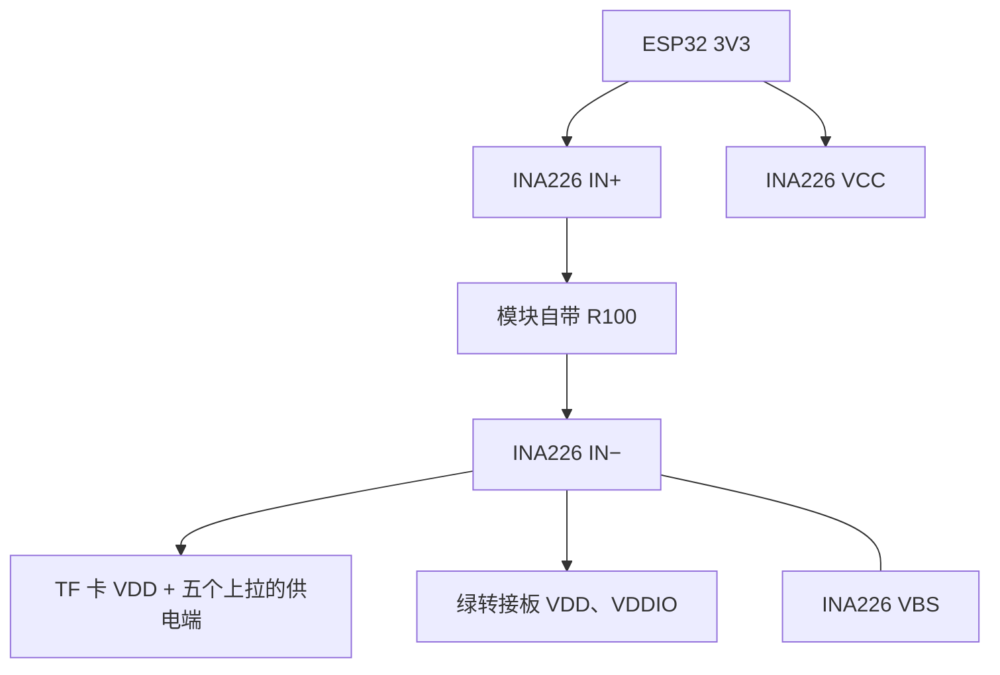

# 整机接线优化方案（2026-10-12）

逐根施工见同目录《整机全部接线总表_2026-10-12.md》，每条连接直接写明两个引脚。

目标：保留 ESP32-S3、IIS3DWB、TF 卡四位 SDMMC 和 INA226 的功能，减少长跳线、跨板供电与交叉。不通过暂时移除模块来实现简化。

本稿已按当前固件核对信号定义，并对照 2026-10-12 提供的整机照片及 INA226 近照安排布局。用户已确认：IN+ 接主控 3V3，IN− 接并联测试电阻。因此目前测量对象是测试负载。下述方案改为测量 TF 卡和振动传感器的 3.3 V 支路，保留各模块功能；实物尚未改接、验收。

## 照片中能确认什么

- 当前是三块分开的面包板：中间长板放 ESP32，上方短板放 TF 卡座，下方短板放 INA226。
- TF 卡旁可见五个电阻；结合此前接线记录，它们应为 CMD、DAT0～DAT3 的上拉。仍应按端点核对，不能只按数量判断。
- 多根跨板跳线过长、相互交叉，部分形成大回环。线的颜色不能证明其用途。
- 新的传感器绿转接板在外围，已接配套排线。全景未拍到排线另一端的蓝传感器板。
- INA226 近照可见 R100 分流电阻及各脚标字。IN+/IN− 远端由用户说明确认；VBS 的局部跳线仍需按新接线表核对。

## 建议整机布局

目标是集中到一块 830 孔主板和一块 400 孔扩展板，蓝传感器板通过配套排线外接。先断电预摆，确认模块、USB 插头和卡片插拔空间足够后，再逐组改线；这是布局建议，不是已经验证的孔位图。

具体安排：

1. **ESP32 留在长板上。** 按实物丝印找到 IO38～IO47 和 IO10～IO17 两组位置，不按照片左右或旧孔号猜引脚。
2. **TF 卡座移到长板空闲区，靠近 IO38～IO47。** 五个上拉跟着卡座移过去，卡座、上拉、电源支路组成一个局部区域；保留插拔卡的空间。
3. **INA226 移到长板另一空闲区，靠近 IO16、IO17。** SDA、SCL 用短线直达，VBS 到 IN− 做成模块附近的短跳线。IN+ 接主控 3V3，IN− 给 TF 卡和传感器供电，见下面的供电图。
4. **一块 400 孔板用于传感器绿转接板。** 紧靠 IO10～IO13 这一侧，四根 SPI 线直接走到绿板。安装前核对两排排针间距和面包板导通方向，不能强压或使两排脚互相短接。
5. **蓝板留在板外。** 配套排线负责连接绿板与蓝板；后续将蓝板可靠固定到被测对象，避免悬空晃动改变测量结果。
6. **多余的一块 400 孔板在迁移并复测通过后收掉。** 已确认的并联测试负载移出日常装配、保留作复测；TF 卡的五个上拉和 INA226 板上的 R100 保留。

如果预摆时卡座或 INA226 遮挡接口、接线孔，先把现有两块短板紧靠长板固定。两块板是压缩布局的目标，不能为了板数强塞模块。

## 信号分成三束

| 模块 | 模块端标字 | ESP32 GPIO |
| --- | --- | --- |
| IIS3DWB 绿转接板 | CS | IO10 |
| IIS3DWB 绿转接板 | SDA（SPI 输入） | IO11 |
| IIS3DWB 绿转接板 | SCL（SPI 时钟） | IO12 |
| IIS3DWB 绿转接板 | SDO（SPI 输出） | IO13 |
| INA226 | SDA | IO16 |
| INA226 | SCL | IO17 |
| TF 卡座 | CLK | IO38 |
| TF 卡座 | CMD | IO39 |
| TF 卡座 | DAT0 | IO40 |
| TF 卡座 | DAT1 | IO41 |
| TF 卡座 | DAT2 | IO42 |
| TF 卡座 | DAT3 | IO47 |

合计 12 根信号线，适用于当前四位 SDMMC、四线 SPI、I2C 的接法。改用其他接口可能减少线数，但需另改固件并重新验收吞吐和稳定性。

## 当前固件不需要的信号线

- IIS3DWB INT1 → IO9：固件实际轮询状态寄存器，未读取 INT1 引脚。
- INA226 ALE/ALERT → IO15：固件未使用 ALERT 引脚。
- TF 卡座 SD-CD：当前固件未使用卡检测引脚。
- IIS3DWB INT2、OCS、CSX、SDX、OSDO：本次四线 SPI 接法不使用。

以上是针对当前固件的结论。如果这些线原来就没接，实际不会减少线数。后续改成中断触发或其他采集方式时，应重新核对。

## 电源与局部接线

### 新供电路径：用实际外设代替并联测试负载

所有 GND 以及 TF 的 VSS 接公共地。该图只表示正端供电路径，不包括信号线和完整回流路径。

| 连接 | 新接法 |
| --- | --- |
| INA226 IN+、VCC | 分别接主控 3V3 |
| INA226 IN− | 给 TF 卡和传感器供电，撤去接并联测试电阻的支路 |
| INA226 VBS | 在模块附近用短线接 IN− |
| TF VDD | 接 INA226 IN−，撤去原来直接接主控 3V3 的供电支路 |
| TF 五个上拉的供电端 | 一起接 INA226 IN−；每个电阻的信号端仍分别接 CMD、DAT0～DAT3 |
| 传感器绿板 VDD | 接 INA226 IN− |
| 传感器绿板 VDDIO | 在板边用短线接绿板 VDD；已有滤波支路则保留滤波 |
| INA GND、TF VSS、传感器 GND | 接公共 GND，最终连接主控 GND |

同一个引脚需要接多根线时，可用面包板同一组已确认导通的孔进行分接，不往一个杜邦插头里塞多根线。主控 3V3 分接给 INA226 VCC、IN+；INA226 IN− 分接给 VBS、TF VDD、绿板 VDD、五个上拉的供电端。两组分接不能混在同一组导通孔中。

- INA226 的 IN+ 在分流电阻的电源侧，IN− 在负载侧；VBS 是总线电压测量端，VCC 是芯片自身供电，依据 [TI 引脚说明及应用电路](https://www.ti.com/lit/ds/symlink/ina226.pdf)。
- 不能用外部跳线短接分流电阻前后两端，或同时保留外设从主控 3V3 直供的旧支路，否则会绕过测量通道。
- 各模块使用短供电和地线支路，避免地线经另一块模块串接。共地不等于电源正端全部直接并接。
- TF 卡供电及地线尽量短；此前已发生地线压降，优化时必须保留可靠回路。
- 传感器 VDD、VDDIO 都需要供电。若两者使用同一未经分离的 3.3 V 电源，可在转接板附近短接后共用一条供电支路；若两路电源分别加过滤波，先核对后再调整。
- **测量边界：TF 卡、上拉和传感器。** 不包含 ESP32 自身、其板载稳压器损耗、INA226 自身的供电消耗。整机输入功耗需要另核对上游供电路径，不能把本接法的读数标成整机功耗。
- 面包板分接孔先断电量通断；不要假定相邻孔或不同板间天然连通。

## 电阻如何处理

| 电阻用途 | 处理 |
| --- | --- |
| TF 卡 CMD、DAT0～DAT3 的五个 10 kΩ 上拉 | 保留，集中在卡座附近；五个公共电源端可共用当地供电点 |
| INA226 板上的 R100 分流电阻 | 保留，不拆焊、不跨接 |
| 用户确认的 INA226 并联测试负载电阻 | 按新供电路径替换为真实外设后，移出日常装配，留作复测 |
| 其他用途未确认的电阻 | 标记端点，确认后再处理 |

INA226 板上 IN+ 和 IN− 之间有低阻分流电阻，断电蜂鸣档可能对两端都蜂鸣。因此不能仅靠“对 IN+ / IN− 都响”判断一根线接在哪一端；应跟随单根线追踪，必要时断开该线一端后测线本身的通断。

## 布局原则

- ESP32 做中心；TF 卡座靠近 IO38～IO47 的引出位置。
- 传感器绿转接板和 INA226 靠近 IO10～IO17 的引出位置。
- 蓝传感器板用配套排线连接绿板，可放在板外，后续固定到被测对象。
- 三组信号线分别成束、按相同路径走，优先换成合适长度的线。不要将剩余长度盘成大圈。
- 保留 TF 卡 CMD、DAT0～DAT3 各自的 10 kΩ 上拉电阻，公共供电端可在卡座附近集中。
- 保留现有去耦电容；优化线束不能以去掉必要的稳定性元件代替。

## 实施顺序与验收

1. 断开所有 USB 和其他电源。标记原有线两端，先预摆布局。
2. 迁移 INA226，核对 SDA/SCL、VCC/GND、VBS 和测量端。并联测试负载撤出日常装配。
3. 迁移 TF 卡座及五个上拉，按表逐根替换成合适长度的线；TF 供电及上拉供电接 INA226 IN−。断电核对端点和分接孔，再上电量 INA226 IN− 对主控 GND，应接近主控 3V3。若明显下降，断电查回路。随后做卡识别及短写入、完整读回，并观察 INA 电流是否随读写活动变化。
4. 断电后装入传感器绿转接板，连接四根 SPI、VDD、VDDIO、GND；VDD 接 INA226 IN−，VDDIO 在绿板边短接 VDD，配套排线连蓝板。上电先核对 WHO_AM_I、静置读数和轻微移动响应，再做真实采集。
5. 三组信号线沿各自路径整理，留少量检修余量，不把多余长度盘成大圈。先逐组验证，再固定线束；跨板供电和地线需明确连接并测通断。
6. 最后同时运行实时显示和 TF 录制，检查真实采集与写入连续性。此前 TF 卡合成数据测试通过，不等于新传感器的整机采集已经验收。

IN+/IN− 的远端去向已收到。下一步按上述顺序进行实物改接；每组改接后通过相应复测再固定线束。两块板的布局仍须以实物预摆为准。

依据：

- 当前工程 `面包板样机_固件/include/config.h`、`src/main.cpp`、`src/recorder.cpp`。
- [ST 套件与配套转接板说明](https://www.st.com/en/evaluation-tools/steval-mki208v1k.html)
- [ST 套件原理图](https://www.st.com/resource/en/schematic_pack/steval-mki208v1k_schematic.pdf)
- [TI INA226 数据手册](https://www.ti.com/lit/ds/symlink/ina226.pdf)
- [ESP32-S3 SD 上拉要求](https://docs.espressif.com/projects/esp-idf/en/stable/esp32s3/api-reference/peripherals/sd_pullup_requirements.html)
